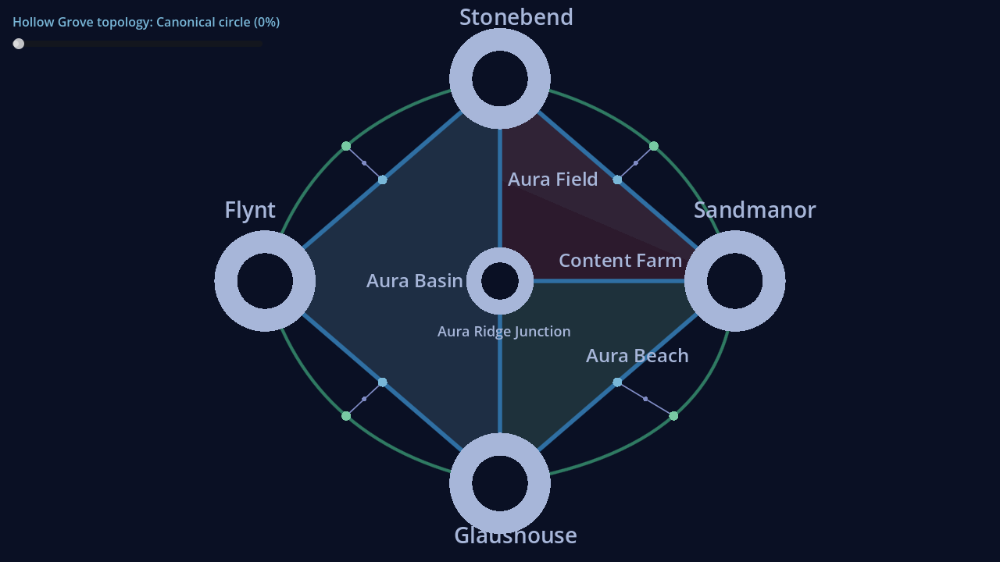
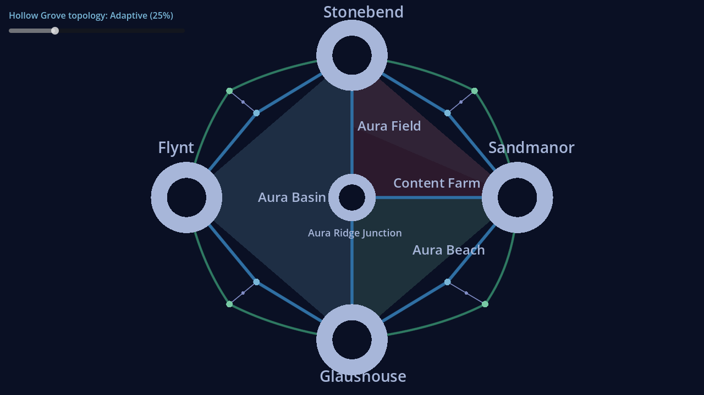
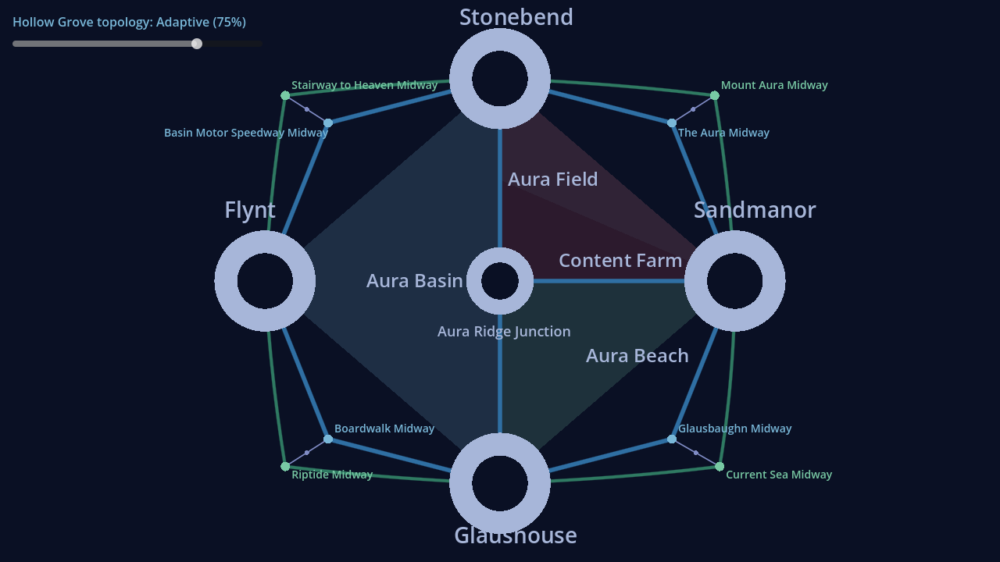
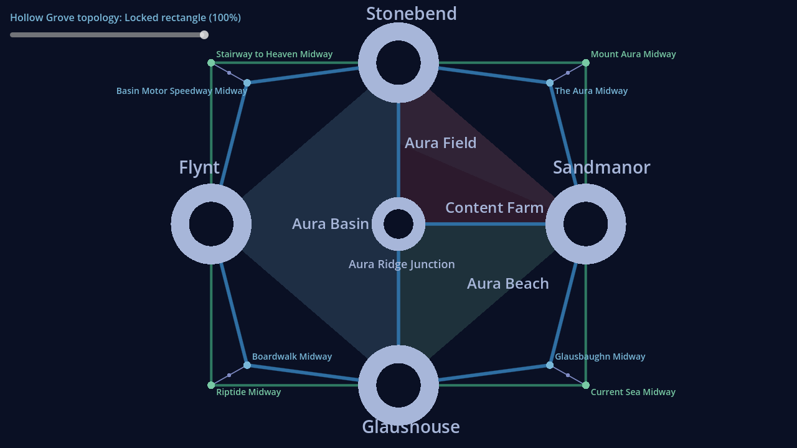

# Hollow Grove Morph Visual Approval V1

- Status: approved visual checkpoint sequence
- Review date: 2026-08-25
- Renderer: Godot 4.7.2, OpenGL compatibility renderer
- Capture size: 1280 × 720
- Geometry authority: `src/world/adaptive_midpoint_hinges.rs`
- Presentation contract: `artifacts/hollow_grove_adaptive_morph_v1.json`

## Approval criteria

| Pose | Result | Visual lock |
|---|---|---|
| 0% | Pass | Canonical circular route geometry and all fixed anchors are preserved. |
| 25% | Pass | All eight route lanes remain connected and visibly isolated. |
| 50% | Pass | Midway motion is continuous and the region stack remains fixed. |
| 75% | Pass | All Midway labels remain readable as the corner structure becomes explicit. |
| 100% | Pass | The four outer corners are symmetric and every inner slot remains inset. |

Across every pose, Aura Field and Content Farm remain the two halves of Aura
Farm; Aura Beach remains the complete triangle beneath them. Aura Ridge stays
fixed as the central spine. Glausbaughn remains the straight southeast lane and
Current Sea remains its curved companion. No visual checkpoint changes route
identity, traversal authority, fixed anchors, or region polygons.

The canonical circle is not forced into artificial bilateral curve symmetry:
Current Sea and Mount Aura retain their established, distinct circular curve
controls. Their Midway targets resolve into exact rectangular symmetry at
100%.

## Approved renders

### Canonical circle — 0%



### Adaptive — 25%



### Adaptive — 50%


### Adaptive — 75%



### Locked rectangle — 100%



## Render digests

| Pose | SHA-256 |
|---|---|
| 0% | `41b7a522a552b0218ca22adcc11ed8cae2d2717c3c80cf4be9a017a7d616c807` |
| 25% | `4745814397f03ab9108920b9207cf8790c41bca98b2b7eaa371b147fbb2d2247` |
| 50% | `977de8b92a324d04d52db6b04cfaff0a22557af704a5624a4c1605e737bff595` |
| 75% | `9b31c3837ebf06077789939f14c8911a53d3117a0f0a3c497b765781a2809dd2` |
| 100% | `b6bdb861130f6488c763557803d3c8952b935bcf45cfbf673616d5a02db40441` |

## Reproduction

```bash
HOLLOW_GROVE_ROOT=/absolute/path/to/hollow_grove \
godot --display-driver wayland --rendering-method gl_compatibility \
  --path hueman_godot \
  --script res://scripts/morph_checkpoint_capture.gd -- \
  /absolute/path/to/hollow_grove/artifacts/hollow_grove_morph_checkpoints
```
