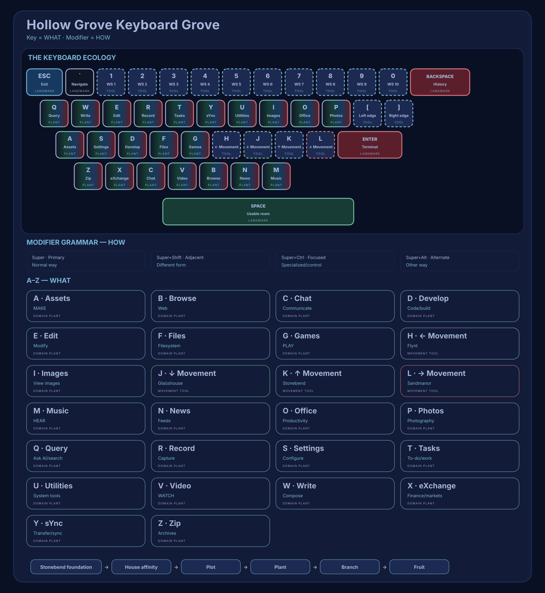

# Hollow Grove Keyboard Grove Map

Status: deterministic generated projection; not constitutional authority

> Generated from `packaging/hollow-grove-general/etc/hollow-grove/keyboard-grove.json`.
> Do not edit this file or the SVG by hand.



## Reading

Stonebend supplies the stable foundation. House landmarks carry direct
constitutional meaning; plants occupy mnemonic letter plots; modifier
branches remain inside a plant; applications and actions are replaceable
fruit. Tools use the same binding grammar but operate on the desktop
environment instead of opening a domain.

## Admitted Plants

| Plot | Plant | Affinities | Branches |
|---|---|---|---|
| `O` | Office | Sandmanor | Primary: Writer; Adjacent: Calc; Focused: Impress; Alternate: Draw; Focused Alternate: Math |
| `M` | Music | Flynt + Glaüshouse | Primary: Library; Adjacent: Visualizer; Focused: Play/Pause; Alternate: Status |

All other letter groups remain provisional launch families. Appearance
on the keyboard does not admit a plant.

## Regeneration

```bash
./packaging/hollow-grove-general/generate-keyboard-grove-map.py
./packaging/hollow-grove-general/verify-keyboard-grove.sh
```
