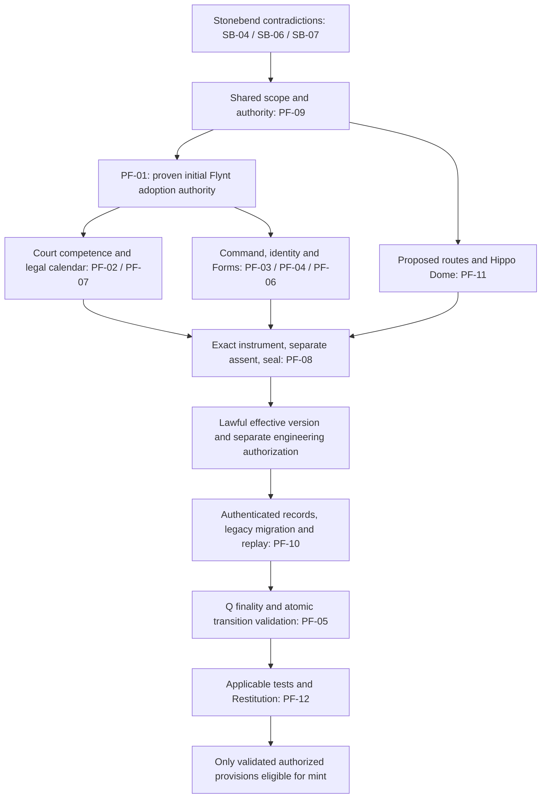

# Stonebend ↔ Flynt parity closure — 26 October 2026

**CREATOR-APPROVED PROPOSED DESIGN / NOT ENACTED LAW.** This is a focused
documentation and read-only source review, not a new constitutional authority.
**STONEBEND_FLYNT_PARITY_DOCUMENTED / READY_FOR_LAWFUL_ADOPTION_REVIEW** describes
the documentation deliverable. Legal activation remains
**BLOCKED_NO_INITIAL_ADOPTION_AUTHORITY**. Nothing is enacted, enabled or minted.

**Current geography correction — V2, 26 October 2026:** the
[corridor and Hippodrones annex](STONEBEND_FLYNT_CORRIDOR_HIPPO_DOME_HIPPODRONES_GEOGRAPHY_SUPPLEMENT_V2_2026-10-26.md)
supersedes the earlier physical-layout interpretation below: one outer curved
road with two directional names, plus one straight B.M.S. chord. The Hippo Dome
stands on flat land between arc and chord; Hippodrones is its concession-crew
brand. This remains proposed design. Earlier chronology and line citations
record the parity checkpoint; use section links for the current handoff.

Parity means comparable completeness of lawful authority, evidence, continuity
and review, while preserving each House's distinct government. It does not mean
matching election thresholds or transferring jurisdiction.

## Baseline, sources and status vocabulary

Reviewed the current intentionally dirty worktree on `os/package-foundation`,
HEAD `d51f506d3a4d9f00381d5e4d44471b316f7a5c1c`: **50 modified tracked files,
52 individual untracked files, zero staged paths**. A pre-edit SHA-256 snapshot
captured 1,255 Git-listed tracked/nonignored untracked files. Existing edits
are the preservation baseline, not changes attributed to this pass.

The repository has no root `start.md`; the actual handoff is
`/home/warren/start.md`. Read the five prescribed Flynt/Syndicate handoffs in
order, then the amendment ledger and canonical College proposal. The existing
College integration is complete: repository Markdown, supplied standalone
Markdown and documentation-pass `SPEC_START`/`SPEC_END` payload match exactly
(36,678 bytes; SHA-256
`b3d91bb5de7fd1c46690653ffdef83bd092640d4591c654378421c1679c6e06e`).
The [canonical College V1](FLYNT_ELECTORAL_COLLEGE_WARDEN_PARLEY_PROPOSED_CONSTITUTION_V1.md)
and its [decision addendum](FLYNT_REV_C_AMENDMENT_DECISIONS.md#electoral-college-decision-addendum-v1--26-october-2026)
remain intact. Its A/C/D/E labels are explicit; B/F/G are still unverified
historical label mappings. The master's different §99 letters do not resolve them.

Actual source locations, rather than presumed consolidation filenames:

| Source | Scope and authority limit |
|---|---|
| `STONEBEND_CONSTITUTION_V2.md:3–14`; `STONEBEND_REV100_GOVERNANCE_AMENDMENT.md:3–19` | Current repository consolidation and its controlling Revision 100 integration. Both distinguish implementation approval from an in-world ratification event. No separate Stonebend consolidation file was found in the repository filename search. |
| `STONEBEND_THREE_GATES_OFFICES_AND_TITLE_SCOPE_V1.md:1–16`; `STONEBEND_TITLE_LIFECYCLE_AND_CONSTITUTIONAL_CONTINUITY_V1.md:1–23` | Follow-on compatibility supplements. Explicit supersession notices preserve scopes, lifecycle and historical readers while retiring former selection/removal/Lazerhorn rules. |
| `HOLLOW_GROVE_WHOLE_CONSTITUTIONAL_RECONCILIATION_V1.md:1–40,122–145` | Actual repository four-House reconciliation, dated July with later foundation results. Its foundation closure is not enactment of October governance proposals. |
| `/home/warren/HOLLOW_GROVE_REV_C/HOLLOW_GROVE_MASTER_CANON_WORKING_REV100_TUI_HANDOFF.md:13–17,47–57,97–101,1001–1078,1761–1806` | Actual current design bundle, outside the repository. Contains the active Stonebend design and four-House design reconciliation; explicitly separates design approval from enacted authority. No second external reconciliation file is assumed. |
| `/home/warren/Downloads/HOLLOW_GROVE_STONEBEND_FLYNT_PARITY_AND_FOUR_HOUSE_MINT_PLAN_2026-10-26.md:44–61` | Companion master plan; PF-01–PF-12 below retain its exact issue meanings. This report is the repository audit result, not a duplicate College specification. |
| `HOLLOW_GROVE_WHOLE_CONSTITUTIONAL_INTEGRATION_AUDIT_V1.md:3–8,24–42`; `docs/REV100_INTEGRATION_STATUS.md:3–14,100–114`; `docs/FLYNT_REV_C_CONTINUATION.md:578–645,758–831` | Historical discovery audit, later Stonebend integration checkpoint, and latest relevant Flynt review/integration evidence. Old “no Court archive” findings and old next-task lists must be compared with current sources, not repeated as current fact. |

| Classification | Meaning in this report |
|---|---|
| `ENACTED_SOURCE` | An existing controlling repository law provision within its stated scope. This classification is not independent authentication of an external ratification event. |
| `CREATOR_APPROVED_PROPOSED` | Selected target design; does not establish in-world adoption or activation authority. |
| `OPEN` | A required legal parameter, provenance record or decision remains unproved. |
| `SOURCE_CONFLICT` | Cited sources differ or retained operative wording remains ambiguous; preserve both pending authorized reconciliation. |
| `LEGACY_SUPERSEDED` | Superseded meaning under an explicit source notice, or superseded active design; historical bytes and identifiers remain valid evidence. State which sense applies. |
| `IMPLEMENTED_BOUNDED` | Inspected implementation within an explicit trust/record boundary. Does not mean live authentication, legal adoption or newly executed tests. |

Revision 100 source files call themselves amendments and control their current
repository adapters. Their express no-fabricated-ratification clauses prevent
using those labels as proof of an actual adoption. Accordingly, the new
governance designs below are `CREATOR_APPROVED_PROPOSED`, with their existing
adapters separately `IMPLEMENTED_BOUNDED`; this pass neither revokes source
text nor upgrades an approval into legal provenance.

## A. Stonebend first: authority and contradiction ledger

| ID / status | Current source and finding | Required disposition before activation or mint |
|---|---|---|
| SB-01 — `ENACTED_SOURCE`; newer office selection `CREATOR_APPROVED_PROPOSED` | `STONEBEND_CONSTITUTION_V2.md:54–73,77–100` separates Freemason Claim, Hypergiant Title and Proliteriate Yield; one sovereign, no power counting as all three. `STONEBEND_REV100_GOVERNANCE_AMENDMENT.md:21–43` separates professional Forms, three singular offices, institutions and distributed witnesses. High Freemason is the same Freemason's seal capacity, stable `office.stonebend.high-freemason`, not a fourth office. | Preserve the triangle and ordinary eight-Form ladder (`STONEBEND_REV100_GOVERNANCE_AMENDMENT.md:94–100`). Establish actual version/adoption provenance for changed office selection; no office from mastery, Agency rank or witness mandate. |
| SB-02 — `CREATOR_APPROVED_PROPOSED`, `IMPLEMENTED_BOUNDED`, `OPEN` | `STONEBEND_REV100_GOVERNANCE_AMENDMENT.md:67–100` specifies citizen majority/top-two Acclamation after vacancy and independently verified Justice/Claim/Yield evidence; indefinite Hypergiant tenure. Trial stages are Challenge → Defense → Proof → Judgment → Reckoning. One current professional officer initiates; removal needs both current professional tenures plus independent findings. `src/world/stonebend/governance.rs:1094–1124,1263–1319` implements bounded selection/removal. | Acclamation selects; Trial does not. No removal vote from vacancy, recusal or a former tenure, and no Title awarded to the challenger. Enact exact standing, proof, notice, appeal and vacancy parameters; qualify the authorized Court and actual records. |
| SB-03 — `CREATOR_APPROVED_PROPOSED`, `IMPLEMENTED_BOUNDED`, `OPEN` | Professional branch majority/runoff, six-year terms, three-year stagger, unlimited eligible reelection, remainder-only special terms, and 20% petition / 40% valid turnout / >50% recall are recorded in `STONEBEND_REV100_GOVERNANCE_AMENDMENT.md:45–58`. Cohorts/rolls/proof standards are not production defaults (`:102–118`). Code checks term and recall boundaries at `src/world/stonebend/governance.rs:1130–1162,1203–1250`. | Authenticate branch-specific electors and eligibility, exact calendar and independent review. Do not export these percentages to Flynt commanders, Registrar, Parley or Tross. No new special-election deadline is inferred. |
| SB-04 — `SOURCE_CONFLICT` | `STONEBEND_CONSTITUTION_V2.md:173–180,458–459` requires certified professional election and independent seal transfer, but `STONEBEND_CONSTITUTION_V2.md:199` still says institution nomination → Proliteriate review → Hypergiant confirmation. The revision's control clause is `STONEBEND_REV100_GOVERNANCE_AMENDMENT.md:13–19`. | Authorized review must identify superseded appointment text and distinguish any surviving qualification/recognition review from selection of the officeholder. Preserve both texts now; do not silently use the old confirmation sentence to handpick a winner. |
| SB-05 — `ENACTED_SOURCE`, `CREATOR_APPROVED_PROPOSED`, `IMPLEMENTED_BOUNDED` | Seals bind lawful decisions and cannot forge authority (`STONEBEND_CONSTITUTION_V2.md:282–284`). New tenure seal continuity is explicit at `STONEBEND_REV100_GOVERNANCE_AMENDMENT.md:60–65`; code rejects reused seals and incoming/outgoing self-certification (`src/world/stonebend/governance.rs:1164–1185`). Vacancy has no active bearer seal. | Keep independent seal transfer, election certification, amendment sealing and House ratification separate. Preserve closed seals as history. Final Permanence Seal authorization remains a distinct Hypergiant role (`STONEBEND_CONSTITUTION_V2.md:543–554`), not a reason to rename every seal issuer or grant Freemason ratification power. |
| SB-06 — `SOURCE_CONFLICT`; shared Court `ENACTED_SOURCE` | `STONEBEND_CONSTITUTION_V2.md:330–334` retains Proliteriate initial judgment and Hypergiant high appeals, including high office/multi-House matters. The one shared judiciary has interpretation/error/protection powers but no sovereignty or amendment-ratification power (`MINOAN_COUNTY_COURT_SYSTEM_AND_RESTITUTION_CYCLE_V1.md:7–61,193–222`). | Specify the surviving local administrative hearing versus independent judicial appeal, recusal and referral. No executive self-review of a Trial and no second Court. The existing Trial adapter preserves external Court references; it does not itself open/adjudicate the shared docket (`STONEBEND_REV100_GOVERNANCE_AMENDMENT.md:120–129`). |
| SB-07 — `LEGACY_SUPERSEDED` in new design/explicit supplements; `SOURCE_CONFLICT` in shared source | V2 retires Lazerhorn from current accession and geography (`STONEBEND_CONSTITUTION_V2.md:102–108,269–272`); both follow-on supplements mark old procedures legacy at lines 1–4. Yet `HOLLOW_GROVE_COMPROMISE_V1_DRAFT.md:866–875` still requires the old removal/ascent chain and Lazerhorn. | Reconcile the exact shared clauses through reviewed scope/assent. Preserve old `Diamond` and Lazerhorn records/readers; never rename the gate into Stairway or impose any new route as an Acclamation test. Retirement in approved design is not a completed route migration. |
| SB-08 — `IMPLEMENTED_BOUNDED`, `OPEN` | Explicit legacy professional evidence can continue a proven tenure/seal, without inventing election dates (`STONEBEND_REV100_GOVERNANCE_AMENDMENT.md:139–169`). Closure history in the governance archive differs from institutional projection and a separately issued registry Tombstone (`:131–146`). | Preserve source snapshots, election/rule/tenure/mastery/seal IDs and independent evidence. Reject missing or incompatible legacy facts; no source-holder deletion to force import, no silent XP reassignment, no claim that a snapshot alone stores the full governance archive. |

## B. Shared bridge and proposed Hippo Dome addendum V1

The existing [authority map](../REPOSITORY_AUTHORITY_MAP.md) remains the index;
this table is a scoped comparison, not a competing constitution. Its root rule
is `REPOSITORY_AUTHORITY_MAP.md:21–42`; the current Stonebend addendum is already
indexed at `REPOSITORY_AUTHORITY_MAP.md:712–726`. The Compromise governs shared
coexistence, delegates detailed Bond/runtime law, and preserves four House
domains. Diagram order in older causal models is not a grant of a superior
sovereign (`HOLLOW_GROVE_COMPROMISE_V1_DRAFT.md:16–49,82–83`).

| Boundary | Stonebend | Flynt | Shared requirement / status |
|---|---|---|---|
| Governing act | Name, bounded Title, Claim, record and Yield | Capacity, scoped recognition and technical evidence | `ENACTED_SOURCE`: no substitution among Name, Proof, Clearance and Recognition (`HOLLOW_GROVE_COMPROMISE_V1_DRAFT.md:242–260`). |
| Sovereign | Acclamation design; Trial checks the incumbent | Existing succession gates; Q terminal actions blocked | Distinct paths; one active sovereign per House, legitimate vacancy allowed. Neither contest, Form, education nor route travel is authority by itself. |
| Elected offices | Two professional offices, 6y / 3y stagger | Three commanders, 6y / 2y stagger; separate proposed Registrar, 4y / max two consecutive counted terms | `CREATOR_APPROVED_PROPOSED`; existing command/professional adapters are `IMPLEMENTED_BOUNDED`. Council membership adds no command office. |
| Ratification | V2 expressly mentions Hypergiant power to ratify lawful amendments (`STONEBEND_CONSTITUTION_V2.md:91`), constrained during vacancy (`:120–124`) | Tross executive power does not expressly supply a first House amendment ratifier (`FLYNT_CONSTITUTION_V2.md:74–79`) | `OPEN`: Stonebend's grant cannot be borrowed for Flynt and does not establish every adoption detail. Scope needs exact-text review. |
| Judicial review | Domain evidence, independent review; retained appeal wording needs reconciliation | Existing procedural review; proposed certification/Parley remedies need explicit competence | `ENACTED_SOURCE` for shared judicial limits; `OPEN` for new remedies. One Court hosted by Minoans, no fifth House or Court sovereign. |
| Seal/public record | Authorized Stonebend recording after proper assent | Required amendment record and separate candidate succession Title | `ENACTED_SOURCE`: Court certification ≠ House ratification ≠ Stonebend seal (`MINOAN_COUNTY_COURT_SYSTEM_AND_RESTITUTION_CYCLE_V1.md:344–358`). A valid seal cannot cure missing consent. |
| Durable history | Governance journal, tenure/seal closure, old snapshots | Governance journal and preserved source-era Tross/Marquise/Form records | `IMPLEMENTED_BOUNDED`; authentication, legal provenance and live docket/gameplay integration remain separate gates. |

The required shared lifecycle is Claim/proposal → public notice → affected-party
testimony → conciliation where appropriate → first procedural hearing → appeal
where challenged → constitutional review/certification → proper ratification →
Stonebend seal/public record → implementation and Restitution review →
equilibrium (`MINOAN_COUNTY_COURT_SYSTEM_AND_RESTITUTION_CYCLE_V1.md:315–376`).
House-local means that House's lawful process; cross-House means each affected
House assents separately; foundational means all four. The combined packet is
not assigned a scope by this audit. Court review may split improperly bundled
provisions. Amendment assent is distinct from the four-House evidence in an
individual succession case.

### Evidence and persistence boundary

`src/constitutional/interfaces.rs:350–399,441–477` already supplies typed
event/aggregate/domain/authority/subject/evidence references, semantic sequence,
causal parent, case/amendment links, remedy institution, failure state, migration
version and history. Court/Restitution and amendment wrappers exist at
`src/world/constitutional_interfaces.rs:252–257,336–406,468–493,737–827,840–863`.
The amendment wrapper checks certification, separate House assents, seal,
implemented-text equality and Restitution. Thus the July audit's absent shared
archive finding is historical, not a current blanket gap.

These are bounded record validators, not a complete authentication service.
For example, `src/world/minoan_court.rs:1402–1448` checks assent scope/evidence
and seal contents but does not establish a supplied signer's legal mandate.
Its sequential review at `src/world/minoan_court.rs:1526–1585` cannot authorize
the missing Flynt ratifier. Stonebend and Flynt clone before reduction and only
commit after successful journal application
(`src/world/stonebend/governance.rs:585–621`;
`src/world/flynt/governance.rs:641–664`). Both reuse the shared archive and replay
through their reducers (`src/world/stonebend/governance.rs:1393–1417`;
`src/world/flynt/governance.rs:1336–1357`). No new replay run is claimed here.

**Proposed future interface requirements, not schema edits:** bind the exact
source/law version, effective interval, named subject/person/office/tenure,
authorized signer and conflict record, evidence authenticity, roll/ballot or
case identity, affected-Yield testimony, separate required House assents,
Court disposition/finality, current seal authority, public redacted record,
closure/Tombstone link and atomic event revision. Preserve rejected attempts,
recurrence under the same case, deterministic replay, idempotence and old
interpretations. FNV checksums and typed string IDs are not signatures. A single
generic envelope does not prove that all domain transitions are integrated.

### The Hippo Dome — CREATOR_APPROVED_PROPOSED / NOT ENACTED

**V1 PHYSICAL LAYOUT SUPERSEDED BY V2.** The paragraphs and connection table
in this subsection retain the earlier proposal as history. References to two
curved paths, a distinct second curved Highway road or a venue among three
physical roads are not current design. See the
[V2 annex](STONEBEND_FLYNT_CORRIDOR_HIPPO_DOME_HIPPODRONES_GEOGRAPHY_SUPPLEMENT_V2_2026-10-26.md#current-physical-layout):
Highway to Hell and Stairway to Heaven are opposite named traversals of one
physical mountain-frontier highway; B.M.S. is the separate straight chord.
Existing source and archive IDs remain protected. “Single new proposal entry”
below describes the V1 checkpoint only; V2 now carries the current design.

**The Hippo Dome** is the approved monumental multi-sport landmark with a
**Colosseum exterior** and **long-oval Circus Maximus / hippodrome interior**.
Its placement is relationally in the open space among the curved descending
Highway to Hell, curved ascending Stairway to Heaven, and straight bidirectional
Basin Motor Speedway. Approval provenance is the supplied final-parity prompt
and companion plan at
`/home/warren/Downloads/HOLLOW_GROVE_STONEBEND_FLYNT_PARITY_AND_FOUR_HOUSE_MINT_PLAN_2026-10-26.md:38–42`.

No coordinates, footprint, stadium roof, additional roads, political
jurisdiction, compulsory Q venue or accession ritual are specified. Those
properties cannot be inferred from “Dome.” Historic Hippodrone/football-field
concepts are superseded as active design and retained as history. The bounded
source search found no such historic venue passage in the consulted repository
design shelves; no purported old site ID or historical quotation is invented.
This section is the single new repository proposal entry for the landmark.

| Connection / target design | Existing source/ID and current mismatch | Disposition |
|---|---|---|
| Highway to Hell — Stonebend → Flynt; curved descending META bend | `src/world/geography.rs:35–62` has ten route variants and no separate Highway road. `src/world/extraction.rs:18–45` uses map `highway-to-hell.deepworks` and site `extraction.highway-to-hell.deepworks` for the existing gallery. `HOLLOW_GROVE_CONSTITUTIONAL_GEOGRAPHY_V2.md:530–534` and `HOLLOW_GROVE_COMPROMISE_V1_DRAFT.md:601–605` expressly exclude an eleventh route. | `SOURCE_CONFLICT` / road `CREATOR_APPROVED_PROPOSED`. A distinct approved road ID and versioned topology migration are still required. Do not reuse either mine identifier or assert a third route already exists. |
| Stairway to Heaven — Flynt → Stonebend; curved ascending META bend | `geography.route.stairway-to-heaven`; gameplay map `stairway-to-heaven.ascent-path` (`src/world/geography.rs:61`; `src/gameplay/world.rs:918`). Curved class is present (`src/world/route_network.rs:199–210`). The later `route.aura-way` description treats Stairway as its ascent-only expression (`HOLLOW_GROVE_CONSTITUTIONAL_GEOGRAPHY_V2.md:468–474`). | Existing identifiers preserved; `OPEN` relationship between the permanent Aura Way and proposed distinct directed road. Do not collapse the Design compatibility route into the new Highway. |
| Basin Motor Speedway — Stonebend ↔ Flynt; straight | `geography.route.basin-motorspeedway`; gameplay map `basin-motor-speedway.production-circuit` (`src/world/geography.rs:60`; `src/gameplay/world.rs:917`). Straight class exists (`src/world/route_network.rs:199–210`). | `IMPLEMENTED_BOUNDED` existing identity/shape; approved bidirectional target remains subject to traversal/migration verification. Display spelling does not rename the legacy key. |

All three directions/shapes are explicit design in
`STONEBEND_REV100_GOVERNANCE_AMENDMENT.md:182–187` and the working master
§3 Article VII. No active edge, angle, route ID, map or frozen traversal event
changed. Physical gate bidirectionality is not permission to reverse a
directional road. An eventual map review must preserve the two curved paths,
one straight path and gallery as distinct identities before placing the venue.

## C. Flynt finishing ledger — PF-01 through PF-12

These retain the companion plan's issue IDs. Cross-references to SB rows above
are deliberate; the College's complete EC-01–EC-30 plan is not duplicated.

| ID / classification | Source check, blocker or bounded finding | Specific next remedy / dependency |
|---|---|---|
| PF-01 — `OPEN` | Full Compromise, Court and Flynt V2 reading establishes the shared lifecycle but no proven first Flynt ratifier/method. Tross executive derivation (`FLYNT_CONSTITUTION_V2.md:74–79`), Warden identity (`:169–176`), and a prior instrument's ratified label (`HOLLOW_GROVE_CANON_AMENDMENT_FLYNT_SYNTHESIS_SANDMANOR_HANDS_V1.md:21–32`) do not supply that grant. | **BLOCKED_NO_INITIAL_ADOPTION_AUTHORITY**. Obtain an existing enacted source and lawful process, or prepare a founding-process design with adoption authority still expressly unresolved. No self-founding 40%/two-thirds referendum. Blocks every new Flynt authority grant. |
| PF-02 — `ENACTED_SOURCE` limits; new remedies `CREATOR_APPROVED_PROPOSED`, `OPEN` | Court already has temporary protection, error review and separately ordered stays (`MINOAN_COUNTY_COURT_SYSTEM_AND_RESTITUTION_CYCLE_V1.md:39–61,193–199,278–290`); elections/numerical rules are deferred (`:378–385`). College blocked-certification remedy and Parley review are proposed (`docs/FLYNT_ELECTORAL_COLLEGE_WARDEN_PARLEY_PROPOSED_CONSTITUTION_V1.md:149–166,190–211`). | After PF-01, expressly settle competent reviewer, standing, recusals, remedy limits and deadlines. Fixed Council 3-of-4 never shrinks. Conflicted Registrar → independently authorized judicial protection, never substitute Parley concurrence. Do not claim all Court stay power is absent or that the new election remedy already exists. |
| PF-03 — `CREATOR_APPROVED_PROPOSED`, `IMPLEMENTED_BOUNDED`, `OPEN` | Six-year commanders / two-year staggering and majority/runoff are approved design; detailed legal gaps are in `docs/FLYNT_REV_C_AMENDMENT_DECISIONS.md:394–461`. Recall rejects (`src/world/flynt/governance.rs:904–905`); special elections reject (`:1130–1134`). Regular elections require supplied policy; seating/finality remain bounded (`:814–855,1136–1162`). | Enact electorate/candidate evidence, notice, quorum/blank/tie/runoff handling, term anchor/cohorts, veto grounds/window/effect, independent appeal, recall and vacancy/special terms. Keep Registrar 4y separate. Neither Stonebend 20% nor Registrar 25% supplies commander recall. Depends on PF-01/02/04/07. |
| PF-04 — `SOURCE_CONFLICT`, `IMPLEMENTED_BOUNDED` | `FLYNT_CONSTITUTION_V2.md:169–176,242–256,401–415` and `FLYNT_MARQUISE_CANON_V1.md:18–33,45–63` preserve Marquise office/organization, Corsair apex and historical custodians. The separate new direct-reporting Mariner office is described in `docs/FLYNT_REV_C_CONSTITUTIONAL_CLOSURE.md:201–253`; the master §99-C/D supplies its design. | Choose exact prospective duty/tenure treatment of each legacy office and preserve person/cover/custody IDs. No name-matching migration or automatic election of old incumbents; exactly three senior peers. Adoption depends on PF-01; migration on PF-10. |
| PF-05 — `ENACTED_SOURCE`, `SOURCE_CONFLICT`, `IMPLEMENTED_BOUNDED` | Existing triggers/gates/challenges are `FLYNT_CONSTITUTION_V2.md:421–445` and `FLYNT_DUAL_LEADERSHIP_AND_MANTICORP_RECIPE_V1.md:16–30`. Q victory is not a listed trigger. Both terminal actions unconditionally return `QSuccessionReconciliation` (`src/world/flynt/q.rs:528–531`); clone/commit preserves original state on error. Source continuity rejects silent Tross restoration (`src/world/flynt/governance.rs:407–430`). | Enact the additional trigger, authenticated finality/challenge handling, separate successor person/tenure, gate bindings and genuine durable vacancy. Preserve all six existing House/Court/seal records unless an exact lawful amendment changes them. No transfer from College degree, command election, Q label, Form or omitted source seat. Depends on PF-01/02/06/08/10. |
| PF-06 — `SOURCE_CONFLICT`, `CREATOR_APPROVED_PROPOSED`, `IMPLEMENTED_BOUNDED` | Older no-combination boundary, combined/perfected order and unique companion persist at `FLYNT_CONSTITUTION_V2.md:3–12,32–45,81–103`. New all-six/three-pair Manticorp and separate three-Current Chimera are bounded design (`docs/FLYNT_REV_C_GOVERNANCE.md:17–24`; master §99-B). | Enact prospective versioned semantics without rewriting Bisynth history, Recipes, companion, Form XP or the historical Tross. Do not infer an extra Chimera prerequisite from `EnactedChimeraPrerequisite`. Manticorp mastery remains distinct from Tross office and may survive office exit. Depends on PF-01 and affected-House clearance/scope. |
| PF-07 — calendar `ENACTED_SOURCE`, `IMPLEMENTED_BOUNDED`; application `OPEN` | A canonical year source **does exist**: Winter Solstice to next Winter Solstice, supplied authoritative observations (`CENTRAL_JUNCTION_SEASONAL_FUNCTIONS_V1.md:45–73`; `FUNCTION_JUNCTION_SEASONAL_WORLD_CYCLE_AND_PERMANENCE_V1.md:123–127,189–192`). `src/constitutional/canonical_calendar.rs:185–220` records boundaries. Flynt tests instead simulate 100 days/year and five veto days (`tests/flynt_rev_c_governance.rs:1–44`). | Narrow the old “missing world year” statement: lawful mapping of civic service/deadline arithmetic to that clock, fractional-year basis, rounding, boundary crossing and actual observations still need explicit election law. Do not assume a fixed day count, equate a quarter-year duration with a seasonal interval, or infer that an adapter policy is already bound to this calendar. Depends on PF-01. |
| PF-08 — `ENACTED_SOURCE`, `CREATOR_APPROVED_PROPOSED`, `IMPLEMENTED_BOUNDED`, `OPEN` | SB-04/05/08 establish the seal conflict and independent tenure interface. Amendment scope, public notice, affected-Yield evidence and distinct seal record remain mandatory (`MINOAN_COUNTY_COURT_SYSTEM_AND_RESTITUTION_CYCLE_V1.md:333–372`). | Resolve selection wording, identify lawful current seal authority and authenticate separate election/tenure, amendment and candidate-succession records. No self-transfer, fake seal, seal-as-ratifier or invented Yield testimony. Needed before adoption record or lawful Q transition. |
| PF-09 — shared hierarchy `ENACTED_SOURCE`; retained clauses `SOURCE_CONFLICT` | Current map already makes the Compromise constitutional root, Bond/runtime subordinate in its domain, and one shared Court (`REPOSITORY_AUTHORITY_MAP.md:21–42,61–70,278–280`). Architecture confirms separate ratification/seal (`HOLLOW_GROVE_CONSTITUTIONAL_ARCHITECTURE_V1.md:175–191`). SB-06/07 identify surviving executive-appeal and Lazerhorn contradictions. | Keep the existing map; reconcile precise contradictory source clauses through authorized review. The July audit is historical; neither its old “Court absent” finding nor October source labels prove full parity. Do not create a second Court or authority map. |
| PF-10 — `IMPLEMENTED_BOUNDED`, `OPEN` | Shared envelopes, Court/Restitution and amendment replay exist (bridge citations above). Governance archives preserve versioned source histories; canonical-holder persistence still cannot encode Tross vacancy by omission (`src/world/persistence.rs:117–131,151–183`). | Specify authenticated adapter bindings, law versions, exact legacy acceptance/rejection, Tombstone linkage, migration/replay/rollback and crash atomicity after lawful adoption. Reuse existing archive ownership; no schema or frozen fixture changes now. Absence of live integration is not absence of all persistence. |
| PF-11 — `CREATOR_APPROVED_PROPOSED`, `SOURCE_CONFLICT`, `OPEN` | The bridge route table and Hippo Dome addendum identify the two existing constitutional route IDs, separate mine identity, absent distinct Highway road in the inspected roster, and Aura Way interpretation seam. | Authorized geography/identity review must settle three directed connection IDs and their versioned mapping, then venue placement. No coordinates, roof, jurisdiction, compulsory ascent or source-law overwrite. Depends on PF-09/10 and applicable House scope review. |
| PF-12 — `IMPLEMENTED_BOUNDED`; current execution `OPEN` | Prior focused Flynt run: 37 passed, exit 0 (`docs/FLYNT_REV_C_CONTINUATION.md:612–624`); later College work ran document checks only (`:806–829`). Stonebend 27 is historical full-suite evidence (`docs/FLYNT_REV_C_CONTINUATION.md:315–318`), not a fresh result. | Record current checks separately below. No cargo, Clippy, formatting or runtime tests run for this pass. Design completeness, lawful adoption, implemented behavior, authenticated integration and component mint eligibility remain separate milestones. |

### PF-11 V2 corridor correction — 26 October 2026

**CREATOR-APPROVED PROPOSED DESIGN / NOT ENACTED.** The PF-11 row above is
the V1 finding. The current [V2 geography annex](STONEBEND_FLYNT_CORRIDOR_HIPPO_DOME_HIPPODRONES_GEOGRAPHY_SUPPLEMENT_V2_2026-10-26.md)
corrects physical layout only: exactly one curved outer highway (Highway to
Hell downhill Stonebend → Flynt; Stairway to Heaven uphill Flynt → Stonebend)
and one separate straight, bidirectional B.M.S. chord. The Hippo Dome occupies
flat interior land between them. Hippodrones names concession workers, not a
new entity type or authority. The external V2 handoff was not located; the
annex records all requirements available in the user's fallback prompt.

The earlier demand for a distinct second curved road is superseded. The
three-connection-ID wording no longer prescribes the physical layout;
physical corridor identity and possible directional traversal IDs require
separate review. No ID is invented here. Permanent Aura Way,
legacy Stairway/B.M.S. projections and Highway Deepworks remain an unresolved
source/representation seam, with historical IDs and semantics preserved.
PF-09/10 and lawful scope review still apply. No law, map, license, calendar
application or Q transition is activated. The other PF issues remain open as
recorded, including **BLOCKED_NO_INITIAL_ADOPTION_AUTHORITY**.

### Numeric design check — NOT operational election law

The canonical College V1 retains amendment turnout **40%** and yes **at least
2/3**; Registrar strict-majority/top-two runoff with no borrowed ordinary
turnout floor; recall **25% petition + 40% valid turnout + >50% yes**; and Parley
**25% valid turnout + >50% yes + written Registrar concurrence**. For 1,000
eligible Wardens the minimum examples remain amendment 400/267, recall
250 signatures then 400/201, and Parley 250/126 plus concurrence.

Registrar term is **4 lawful years**, at most **two consecutive counted
terms**, then one regular-election break. Actual remainder service **≥2 years
counts; <2 does not**. A vacancy election occurs **within 1/4 lawful year** and
fills the original remainder. Council certification needs **at least 3 of 4
fixed seats**. Parley initial assessment is **within 1/16 lawful year**, ordinary
suspension **at most 1/4**, with no reset for repeat votes/equivalent actions.
These do not supply missing year arithmetic or commander law.

## D. Bounded other-House cross-reference

| House / status | Pending reconciliation reference and boundary |
|---|---|
| Sandmanor — `CREATOR_APPROVED_PROPOSED`, `OPEN` | `docs/SANDMANOR_REV_C_PAIRED_PATHS_DESIGN.md:3–44` records the later Quad/Wrangle and Minoan Peninsula four-rung paths, without changing Agency rights, clinical scope or geography. `SANDMANOR_REV100_GOVERNANCE_AMENDMENT.md:24–54` separately retains current three-rank Agency histories, Form mappings and citizen-elected Mino/Cent. Resolve title/qualification, old Faun/Satyr/Hand identity and archive mapping in its own pass; do not import Flynt policy. |
| Glaüshouse — source integration and design boundary; `OPEN` legacy mapping | `GLAUSHOUSE_REV100_GOVERNANCE_AMENDMENT.md:3–14,18–60` distinguishes nine equal Persephone seats, Prima Donna, Nightingale civic admission, independent clinical licensing and unresolved legacy `teri`/other seat mapping. Keep The Call/office vacancy and clinical authorization in their own review; a civic office, College degree or cross-House seal grants no private chart access or care permission. |

These are dependency pointers, not new House audits or approvals. Neither
House's sources, adapters, clinical policies or saves changed. The Syndicate
remains the separate title/design work described in
[its existing handoff](SYNDICATE_REV_C_DESIGN_PHASE.md).

## E. Two-pass dependency plan and next legal decisions

**Pass I — source-authority and design closure, nonoperative.** Finish the exact
Stonebend selection/appeal/Lazerhorn reconciliation packet first; retain the
approved Title–Yield–Claim/Acclamation/Trial design. Use the existing shared
map to review precise House effects and separate scope. Resolve PF-01's source
question before treating any Flynt proposal as adoptable. Complete the exact
Court, command/legacy, calendar, seal and archive requirements; keep Hippo Dome
geography proposed. The report and its future vectors are this pass's products.

**Pass II — separately authorized adoption, then implementation/test/mint.**
For each provision independently: establish lawful adoption authority; follow
notice/testimony/hearing/review and proper House assent; record exact adopted
and superseded text, Court certification, Stonebend seal/public record and
prospective effective version. Only then separately authorize implementation,
versioned migration if required, focused positive/negative tests and applicable
regression/integration checks. Verify implementation/Restitution and actual
authenticated boundaries before calling that particular component mint-eligible.
No whole-project mint follows from one component or from this report.

The graph shows dependencies, not a compulsory single bundled amendment.
PF-01 has no proven incoming authority grant merely because the graph connects
it to shared review. Independent Stonebend documentation may proceed while
Flynt adoption remains blocked; geographic placement need not hold unrelated
properly scoped provisions hostage.

Only the following legal decisions remain actionable here:

1. **Founding authority:** provide a controlling pre-existing Flynt
   ratifier/method source, if one exists. Otherwise consider a proposed initial
   House-process instrument or a proposed foundational enabling instrument;
   both options still need an independently lawful adoption basis and exact
   required House assents. Neither option is selected or authorized by this
   report. Four-House participation alone does not cure an unproved House
   ratifier. No Tross/Council/Registrar/Court/creator is installed by inference.
2. **Stonebend surviving clauses:** identify what survives of V2 line 199 and
   Article XVI, and exactly how Compromise lines 866–894 are reconciled. Preserve
   qualified evidence and constitutional boundaries while specifying selection,
   judicial referral and retired-route status.
3. **Judicial/electoral instrument:** settle the exact new Court remedies,
   conflicted-reviewer handling, Registrar/Parley procedures and separate
   commander election parameters. Preserve all selected College thresholds;
   do not reopen them to compensate for missing authority.
4. **Calendar application:** cite the established solstice-year law, then
   specify its election/service/deadline binding, actual authorized observations,
   fractional-year arithmetic and rounding. Do not legislate with fixture dates.
5. **Q and historical meanings:** choose exact versioned trigger/finality,
   successor-person/tenure/vacancy, retained House gates, Marquise/custodian
   treatment and Chimera/Manticorp interpretation. Preserve earned mastery and
   historical identities. Leave both Q terminal actions blocked until all
   legal and atomic-transition requirements are independently satisfied.
6. **Record and geographic scope:** identify lawful seal/public-record authority,
   authentication and legacy compatibility obligations, plus the road/gallery/
   Aura Way mapping and any required House assent. Venue footprint, jurisdiction
   and further engineering remain unselected; this pass supplies no coordinates.

## Future negative conformance vectors — planned, not implemented or run

**V2 geography amendment to this future plan:** PC-11 below preserves the
earlier checkpoint's wording. Its physical-layout expectation is superseded by
the [CV2-01–CV2-12 matrix](STONEBEND_FLYNT_CORRIDOR_HIPPO_DOME_HIPPODRONES_GEOGRAPHY_SUPPLEMENT_V2_2026-10-26.md#v2-acceptance-and-negative-matrix--planned-only),
which requires one physical outer curve/two directed names, one B.M.S. chord,
a flat venue precinct, bounded worker branding and protected archive IDs.
Other PC/EC requirements are unchanged; no new vector is implemented or run.

These supplement the unchanged College EC-01–EC-30 matrix. An eventual positive
witness must use a genuinely authorized version and authentic evidence; a
passing synthetic fixture never enacts its policy.

| Vector | Attempt | Required rejection/preservation witness |
|---|---|---|
| PC-01 | Incoming/outgoing Freemason self-certifies seal, reuses a closed seal, or seals during bearer vacancy | Reject transfer/use; preserve original tenure, evidence and bytes. A neutral valid election/unique-seal case is the eventual positive control. |
| PC-02 | Trial accuser, past supporter or Hypergiant judges own case; recusal/resignation used to erase conflict; one current professional vote removes | Reject self-review/removal, retain case/conflict history. Two lawful current supports plus independent findings still do not elect successor. |
| PC-03 | Second Hypergiant/Tross, fourth commander, Deputy Registrar, separate High Freemason person or automatic legacy-holder seating | Reject duplicate/invented office; retain true vacancy, persons, historical covers and qualifications. |
| PC-04 | Court-only ratification, seal substituted for House assent, proposed Warden vote founds its own authority, or one House waives another's assent | No adoption/effective state. Preserve proposed text and failed attempt; do not manufacture missing signers. |
| PC-05 | Council 2 yes with a recusal, discretionary tie winner, Registrar self-certification or unlegislated Court certification | No certificate. Fixed 3-of-4 and authorized independent remedy remain required. |
| PC-06 | Parley below 25% turnout, exactly half yes, absent/conflicted concurrence, repeat equivalent directive, unlegislated stay | No ordinary veto/clock reset. Independent authorized stay is a separate record; expire ordinary suspension at its legal ceiling. |
| PC-07 | Flynt commander recall uses Stonebend 20% or Registrar 25%; commander term uses Registrar 4y; fraction computed from test 100-day year | Reject missing/wrong policy. Test exact enacted boundary/rounding separately when available. |
| PC-08 | Q victory plus apparently complete six-gate metadata calls `FinalizeSuccession` or `OpenFinalVacancy` under current rules | `QSuccessionReconciliation`; state and encoded bytes unchanged, including incidental tenure expiry. Missing source Tross must not be silently restored. Existing test references: `tests/flynt_rev_c_q.rs:457–556`; `tests/flynt_rev_c_closure.rs:4–39`. |
| PC-09 | Name, Form, Agency, civic admission, College degree or geographic presence used as another House's permission | Reject cross-House/clinical/private-memory authority leakage; preserve one person and independent consent/credential evidence. |
| PC-10 | Old Marquise/Manticore/Diamond/Bisynth/XP record relabeled; snapshot omission creates vacancy; old gallery ID becomes Highway road | Reject unsupported migration; exact frozen bytes/semantics retained, versioned lawful migration and round-trip/rollback required later. |
| PC-11 | Highway ascent, Stairway descent, curved B.M.S., route ID collapse, Dome-as-fourth-road or Dome-as-succession-gate | Reject unapproved route change; old traversal remains replayable. Future positive map witness must independently verify the three approved directions/shapes and distinct gallery identity. |
| PC-12 | Forged seal/signature with recomputed checksum, duplicate/reordered/partial event, wrong case/law version, Restitution rewriting ratified text | Reject without partial mutation; preserve same-case recurrence, separate assent/seal, closure/Tombstones and authentic history through crash/reload and replay. |

Existing Stonebend coverage references include
`tests/stonebend_rev100_governance.rs:361–492,508–628,707–764,863–998,1037–1192`.
These references identify prior tests available for later execution; they are
not fresh passing results or claims that the new proposal vectors are implemented.

## Verification and disposition

Exact changed repository paths and command exits are recorded in the
[dated continuation entry](FLYNT_REV_C_CONTINUATION.md#stonebendflynt-final-parity-review--26-october-2026).
Checks cover scoped diffs plus direct untracked-file content, local references,
numeric rules, verbatim payload preservation and the session's file hashes.
Citation-range checks establish existence/bounds, not automated legal judgment.
No implementation tests were run; all earlier test totals remain historical.

**STONEBEND_FLYNT_PARITY_DOCUMENTED / READY_FOR_LAWFUL_ADOPTION_REVIEW**

**Activation blocker: BLOCKED_NO_INITIAL_ADOPTION_AUTHORITY. Q remains fail-closed.**
